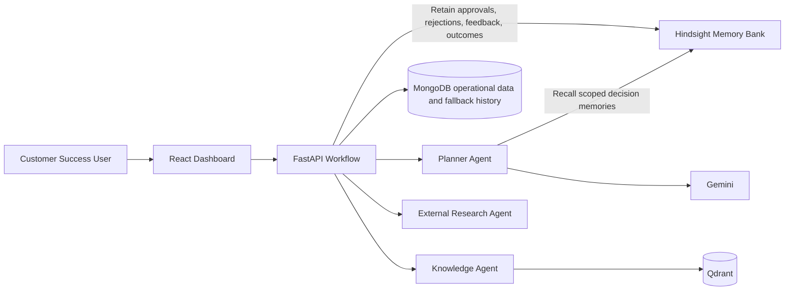

# AegisAI Decision Intelligence

AegisAI analyzes customer accounts, proposes next actions, and learns from reviewer decisions and recorded outcomes. Hindsight provides long-term agent memory; MongoDB continues to store operational records and acts as a fallback for memory writes.

## Architecture



Recommendation decisions and completed outcomes are retained under stable document IDs, tagged by customer and industry. The planner recalls those memories before choosing an analysis strategy. Hindsight is disabled until `HINDSIGHT_BASE_URL` is configured; the app continues using MongoDB history when it is unavailable.

## Enable Hindsight

Install and run a Hindsight API server using the [Hindsight deployment guide](https://hindsight.vectorize.io/developer/installation). The local quickstart serves the API at `http://localhost:8888`.

Use [backend/.env.example](backend/.env.example) as a reference and add these values to `backend/.env`:

```dotenv
HINDSIGHT_BASE_URL=http://localhost:8888
HINDSIGHT_API_KEY=
HINDSIGHT_BANK_ID=aegisai-customer-success
HINDSIGHT_TIMEOUT_SECONDS=30
```

The backend uses the official `hindsight-client` Python SDK. It calls async `aretain()` when recommendations are approved, rejected, or completed, and `arecall()` from the planner. The calls are covered by mocked tests; a live retain/recall requires a reachable Hindsight server and, when applicable, an API key.

## Hindsight Resources

- [Hindsight GitHub repository](https://github.com/vectorize-io/hindsight)
- [Hindsight documentation](https://hindsight.vectorize.io/)
- [Agent memory on Vectorize](https://vectorize.io/what-is-agent-memory)